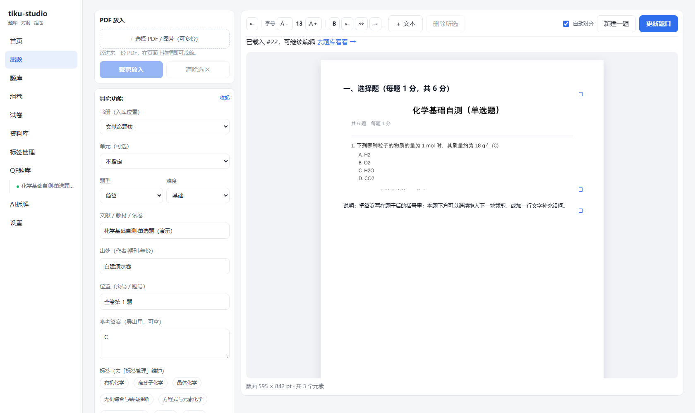
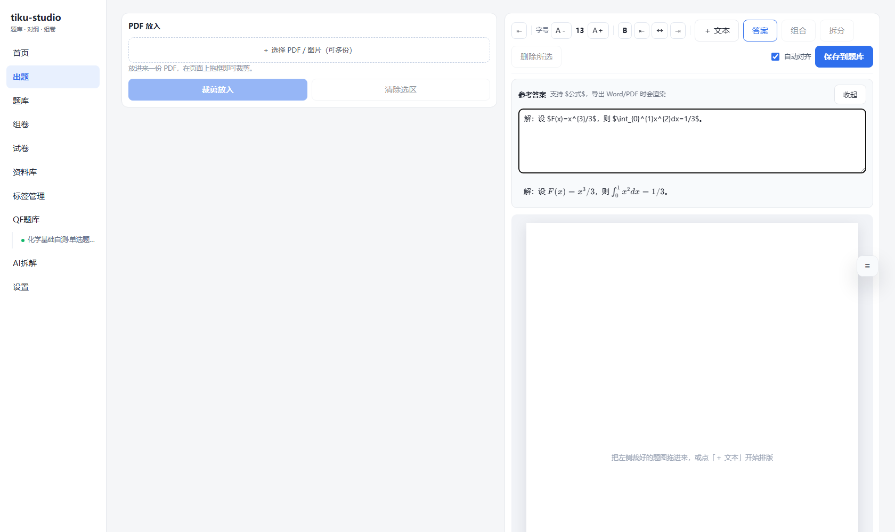
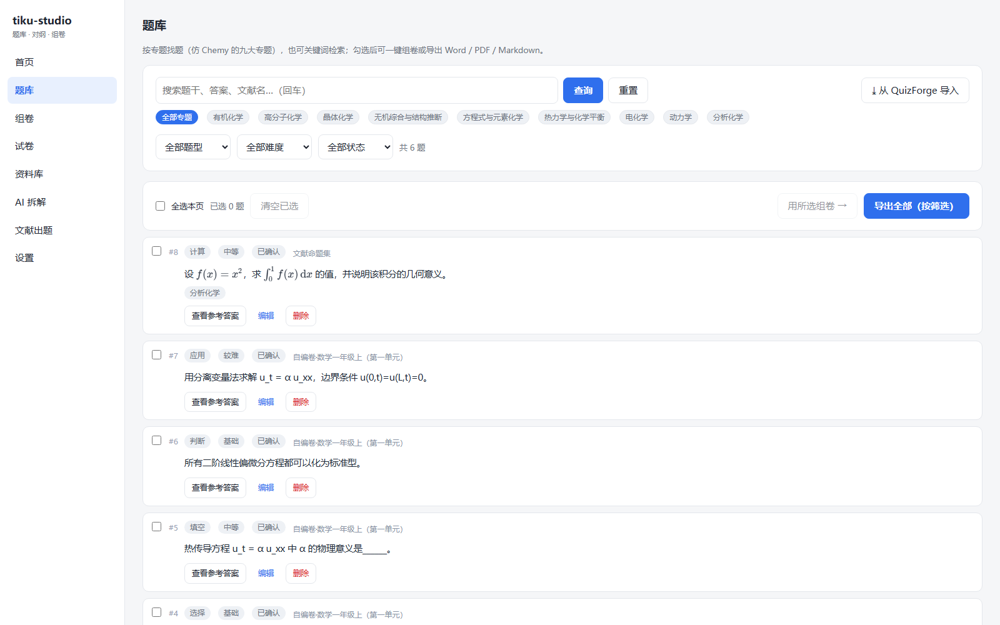
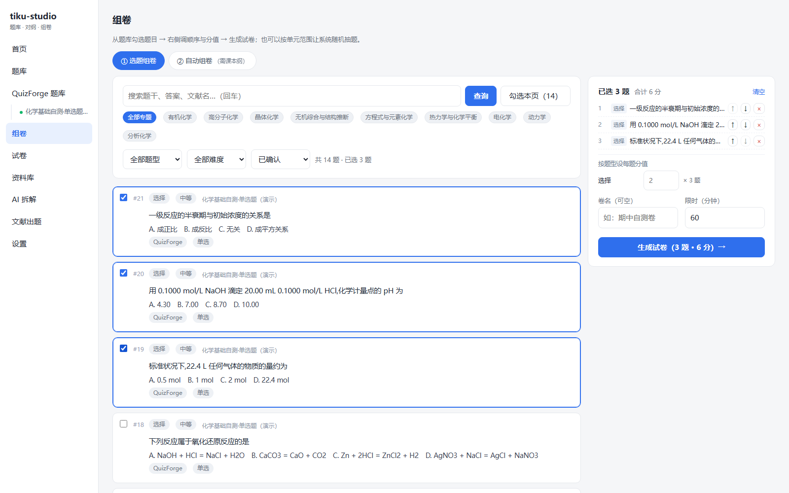
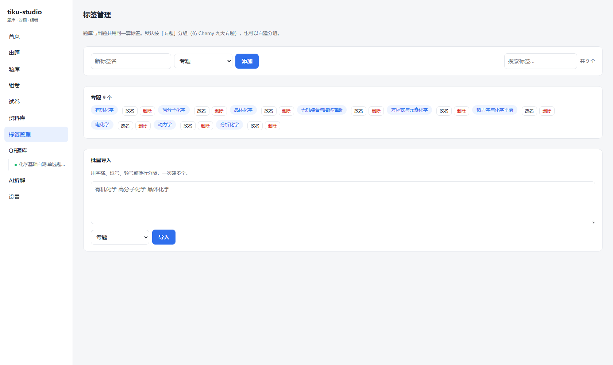
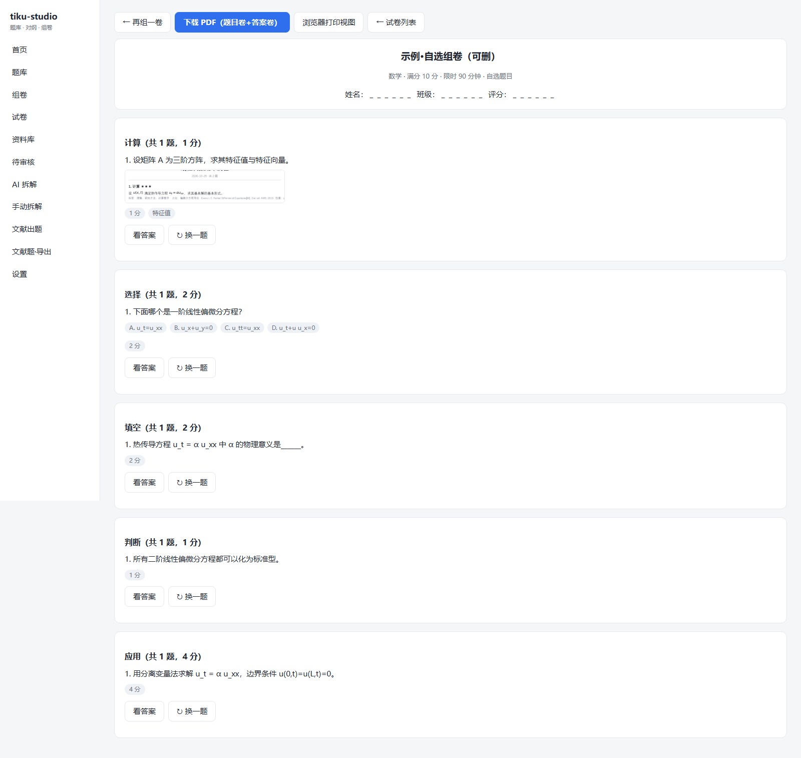
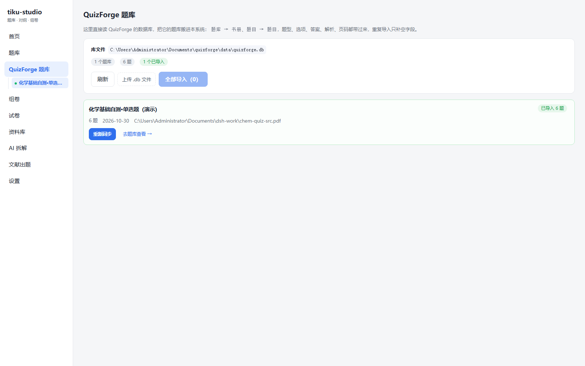

# tiku-studio

**面向高校教师的「文献命题 → 题库 → 组卷 → 导出」工作台。**

把「翻 PDF 找题干 → 裁剪成题图 → 写答案与解析 → 打标签 → 攒成题库 → 组卷 → 导出 Word/PDF」这条重复劳动固化成一套本地可跑的 Web 应用：
左边放文献，右边排题目，画布上所见即所得，保存即入库。

前后端分离（FastAPI + Vue3）· 自带 SQLite · 纯本机运行 · 无云依赖 · MIT

---

## 它能做什么

| 页面 | 路由 | 用途 |
| --- | --- | --- |
| **出题** | `/#/author` | 左边 PDF 框选裁剪，右边 A4 画布自由排版：拖入题图自动对齐、调字号/加粗/对齐、`＋文本` 排版公式、答案就地编辑、元素可多选组合/拆分/复制粘贴；保存即渲染成整页题图入库 |
| **题库** | `/#/questions` | 按专题（Chemy 九大化学专题）筛选 + 关键词搜索；卡片直接显示题干（KaTeX 渲染）与题图；多选后一键「用所选组卷」或导出 Word / PDF / Markdown |
| **组卷** | `/#/compose` | ① 从题库挑题：托盘调序、按题型设分值、总分实时累加；② 按单元范围自动抽题配分 |
| **试卷** | `/#/papers` | 题图与公式正常渲染、单题换题、打印视图、Playwright 一键导出 PDF（题目卷 + 答案卷） |
| **资料库** | `/#/books` | 书册 / 单元 / 知识点骨架，题图与原件归口 |
| **标签管理** | `/#/tags` | 标签分组维护：新增、改名（题目里的旧标签同步）、删除、批量导入、搜索 |
| **QF题库** | `/#/quizforge` | 内置 [QuizForge](https://github.com/cjxxx222/quizforge) 导入：直接读它的 `quizforge.db`，题库→书册、题目→题目，题型/选项/答案/解析/页码一并带过来，重复导入只补空字段 |
| **AI拆解** | `/#/ingest` | 可选：上传 PDF 交给视觉大模型自动拆题（需自备 API Key，实验性） |

## 截图

出题画布（左裁剪 / 右排版，A4 595×842pt，所见即所得）：



答案就地编辑（支持 `$...$`，实时预览）：



题库（专题 chips + 题图 + 多选导出）：



组卷（挑题 → 托盘调序调分 → 生成）：



标签管理 / 试卷 / QuizForge 导入：





## 三分钟跑起来

需要 **Python 3.11+** 与 **Node.js 18+**。

```bash
git clone <本仓库> && cd tiku-studio

# Windows：双击 start.bat（自动建 venv、装依赖、建前端、起服务）
# macOS / Linux：
./start.sh
```

打开 <http://localhost:8100> 即可。**默认是空库**：从「出题」做第一道题，或用 `＋ 放入 PDF` 裁导入库；
也可以在「QF题库」里导入一份现成的 QuizForge 题库。

手机 / 平板访问：同一个 WiFi 下打开 `http://<电脑IP>:8100`。

> 只想要前端静态文件、不想装 Node？把 `apps/web/dist` 预先构建好（`cd apps/web && npm install && npm run build`），后端会自动托管它。

## 目录结构

```
apps/api        FastAPI 后端
  app/routers      books / questions / papers / ingest / manual / authoring / imports / meta
  app/services     组卷引擎、PDF 渲染、画布渲染（compose_render）、导出（docx/pdf/md）、
                   LLM 拆解适配器、QuizForge 导入、对纲校验
apps/api/tests   pytest 用例与最小夹具（fixtures/ 里 1 册课本纲 + 8 道题）
apps/web        Vue3 + Vite 前端（出题/题库/组卷/试卷/资料库/标签/QF题库/AI拆解/设置）
packages/schema 拆解产物的 JSON Schema（本地 Agent 与 API 两种引擎共用）
agent/          本地 Agent 拆解提示词手册
scripts/        import_bundle.py 等脚本
docs/           教程：本地部署 / Docker / Agent 拆解 / API 拆解 / 组卷
data/           你的私有数据（gitignored）：tiku.db、题图库、上传原件
```

## 技术栈

- 后端：FastAPI · SQLAlchemy 2 · Pydantic v2 · PyMuPDF（PDF 转图 / 裁剪 / 画布渲染）· python-docx（Word）· matplotlib（公式转图）· SQLite
- 前端：Vue 3 · Vite · vue-router（hash 路由）· KaTeX（公式）
- 导出：Word（python-docx）、PDF（自绘排版器；试卷另可用 Playwright 打印）、Markdown
- 测试：pytest（`apps/api/tests`）

## 主要接口

| 方法 | 路径 | 说明 |
| --- | --- | --- |
| GET | `/api/stats` | 首页统计 |
| GET/POST | `/api/questions` | 题库检索（`q` / `book_id` / `q_type` / `difficulty` / `tag` / 分页）/ 新增 |
| PUT/DELETE | `/api/questions/{id}` | 改 / 删 |
| GET/POST | `/api/papers` | 试卷列表 / 组卷（`question_ids` 手动选题，或 `textbook_id` + 单元范围自动） |
| GET | `/api/papers/{id}/view` · `/export` | 打印视图 / PDF 导出 |
| GET/POST | `/api/authoring/compose` | 出题画布：保存版面（渲染成整页 PNG 入库）/ 读取回填 |
| GET/POST/PUT/DELETE | `/api/authoring/tags` | 标签库维护 |
| GET | `/api/authoring/export` | 题库导出 `fmt=docx\|pdf\|md`，可按筛选或 `ids` |
| POST | `/api/manual/upload` · `/crop` | 资料页图服务：上传 PDF、按归一化矩形裁剪 |
| GET/POST | `/api/import/quizforge` | QuizForge 库探测 / 导入（也可 `POST /upload` 传 .db） |

完整的交互式文档在 <http://localhost:8100/docs>。

## 数据与隐私

- 所有 PDF、题图、数据库都在本地 `data/`（gitignored），不上传任何服务器。
- 仓库**不含**任何受版权保护的教材/文献扫描件。
- 仅在配置了 LLM API Key 时，「AI拆解」才会把你的 PDF 页面图片发给你选定的模型服务商。

## 参与开发

欢迎 Issue / PR，哪怕是文档措辞的修正。

```bash
# 1) 后端：建 venv、装依赖
python -m venv .venv
.venv/Scripts/activate            # macOS/Linux: source .venv/bin/activate
pip install -r apps/api/requirements.txt

# 2) 前端：装依赖并构建（后端会托管 apps/web/dist）
cd apps/web && npm install && npm run build && cd ../..

# 3) 起服务（热更新开发模式）
python -m uvicorn app.main:app --app-dir apps/api --reload --port 8100
# 前端另开一个终端：cd apps/web && npm run dev

# 4) 测试（独立临时库，绝不碰 data/tiku.db）
python -m pytest apps/api/tests -q
```

约定：

- 提交前请确保 `pytest` 全绿；新增功能最好带一个最小用例（夹具放 `apps/api/tests/fixtures/`）。
- 数据库结构改动请写在 `apps/api/app/db.py` 的 `_migrate()` 里做幂等迁移，不要要求用户删库。
- 前端不引入新的 UI 框架；样式类统一在 `apps/web/src/style.css` 与组件 scoped 样式里。
- Issue 请写清：系统版本、`python --version`、复现步骤、预期与实际结果；能附截图更好。
- PR 请一个主题一个 PR，并在描述里关联对应 Issue。

安全：**不要把任何 API Key、`.db`、PDF 原件提交进仓库**（`.gitignore` 已覆盖，但提 PR 前请再 `git status` 检查一次）。

## Roadmap

- [x] 题库检索 / 对纲校验 / 自动组卷 / PDF 导出
- [x] 本地 Agent 与 LLM 两种 PDF 拆解
- [x] 题库题图化、自由挑题组卷（参考 [Chemy](https://brucejllpku.github.io/Chemy-)）
- [x] 文献出题并入题库、标签独立管理、QuizForge 题库导入
- [x] 大题画布：裁剪拖入、自动对齐、公式排版、组合/拆分/复制粘贴
- [ ] 试卷整卷视图（按「届次 / 试卷」聚合题库，像 Chemy 那样整卷勾选）
- [ ] 出题画布的纯文本版面（保留 markdown 源，后期可纯文本改）

## 更新记录

- **v0.7（2026-10-30）** 开源整理：移除示例题库 `seed/`（默认空库启动）、测试改用最小夹具、
  LICENSE 版权人写明、新增 `CONTRIBUTING`/本 README 的参与开发章节
- **v0.6（2026-10-30）** 大题画布（裁剪拖入 / 自动对齐 / 公式 / 组合拆分 / 复制粘贴 / 答案就地编辑）、
  题库与组卷按专题重做、标签独立成页、QuizForge 内置导入
- **v0.5** 文献出题并入题库、题库题图化、自由挑题组卷、框选坐标修正

## License

MIT。本项目基于 [cy-0754/tiku-studio](https://github.com/cy-0754/tiku-studio) 二次开发（原项目为小学题库与组卷系统），
在其之上重构了题库/组卷形态、加入了文献命题与画布出题、导出与 QuizForge 导入等能力。原始版权声明见 [LICENSE](LICENSE)。

## 更新记录（v0.8，2026-10-31）

- **A 整卷视图**：题库新增「整卷」（相当于某一届 / 某一份卷）这一层。顶部整卷 chips 可筛选、可「整卷加入已选」；选中题目后可「归入整卷…」（支持就地新建卷）或「移出整卷」。接口：GET/POST /api/sets、PATCH/DELETE /api/sets/{id}、GET /api/sets/{id}/question-ids、POST /api/sets/{id}/assign、POST /api/sets/detach；题库查询支持 ?set_id=<id> 与 ?set_id=-1（未归卷）。
- **E 版本历史**：每次编辑（题库内 PATCH、出题页保存、归卷、重排版面）之前自动留一版快照；题库卡片新增「历史」按钮，可查看版本列表并一键回滚，回滚前会先把当前状态存一版，回滚本身也能反悔。接口：GET /api/questions/{id}/versions、GET .../versions/{vid}、POST .../versions/{vid}/restore、DELETE .../versions。
- **F 搜索加强**：关键词支持空格分词（AND），命中范围扩展到题干、答案、解析、文献名、出处、标签、整卷名；标签支持逗号分隔多选（AND），如 ?tags=分析化学,QuizForge。
- **B 画布升级**：出题页新增「页眉页脚」面板（左/中/右页眉、页脚、可勾选「姓名 / 班级 / 得分」栏），保存时会画进题图，且正文自动下移避让；图片块支持「旋转 90°」（快捷键 R）与方向键 1pt 微调（Shift 10pt）。版面指纹纳入页眉页脚，改模板也算新题。
- **题库页改版**：改成 Chemy 式「左侧分类导航 + 右侧题目列表」——左栏 246px 分「专题」「整卷」两组，点击即筛选（带题数）；右侧是搜索、选择栏和题目卡片，宽度随窗口自适应（窄屏自动上下堆叠）。出题页保持「左右各半 + 可拖动「其它功能」浮层」的原布局。
- 数据结构：新增 question_sets、question_versions 两张表，questions.set_id 外键（ON DELETE SET NULL），迁移在 pps/api/app/db.py::_migrate() 幂等执行。
- **题库全图片化**：新增 POST /api/questions/{id}/render、POST /api/questions/render-all[?force=1]，把纯文本题目用同一套画布渲染器生成题图（题干 + 选项分行、支持 \$...\$ 公式、按行数精算页高）；题库卡片改为「有题图就只显示图」，点击全屏放大，卡片内边距与字号一并放大。
- **画布自动裁空白**：出题画布工具栏新增「裁空白」（默认开）——勾选时画布页面会缩到内容底部，保存时后端按内容高度裁剪输出 PNG（`layout.trim` / `layout.trim_pad`），页眉/页脚/姓名栏存在时保留整页；已有题目可在题库卡片上点「裁空白」（`POST /api/questions/{id}/trim`）一键重排裁剪。
- **答案也能裁剪**：出题页左栏新增「裁剪为答案图」，从 PDF 圈一块即作为答案图（可多张，答案面板里可单张删除）；保存后写进 `questions.images`（`caption=答案`），题库「查看参考答案」会连同答案图一起显示。
- **画布编辑增强**：工具栏新增「复制 / 粘贴」按钮（也支持 `Ctrl+C / Ctrl+V`）；选中多个元素点「组合」后成为一个整体，点其中任意一个即整组选中、拖动整体移动、可再「拆分」。

## 更新记录（v0.9，2026-10-31）

- **题目图片化**：题库卡片默认以「整题图片」呈现（服务端用同一套画布渲染器把题干 + 选项排成图），点图可放大；POST /api/questions/render-all 可批量生成。
- **自动裁空白**：出题画布新增「裁空白」开关，保存时按内容底部裁剪页高（有页眉/页脚/姓名栏时保留整页）；题库卡片另有「裁空白」按钮按已存版面重渲。
- **答案图**：「参考答案」面板内可直接「从 PDF 裁剪答案图」（可多张），随题目一起入库，题库「查看参考答案」里显示。
- **设置页改版**（/#/settings）：
  - 常规：数据位置、当前统计、服务与日志说明；
  - 快捷键：八个动作（复制 / 粘贴 / 组合 / 拆分 / 删除 / 旋转 / 新建文本 / 取消）都可自行录制，存本机 localStorage，即时生效；
  - 标签管理：原独立页并入设置，支持分组、改名（同步历史题目）、删除、批量导入。
- **移除 AI 拆解**：删除 
outers/ingest.py、services/ingest_llm.py、/api/settings 与前端 Ingest.vue；投递箱接口保留为轻量 
outers/inbox.py（资料库页仍可导入 data/inbox 里的 bundle JSON）。
- 侧边栏现为：首页 / 出题 / 题库 / 组卷 / 试卷 / 资料库 / QF题库 / 设置。

## 更新记录（v0.10，2026-10-31）

- **组卷画布（PDF 编辑器式）**：/#/compose/canvas
  - 左栏放 PDF/旧卷 → 拖框裁剪 → 拖到右侧画布；右栏「试卷设置」可从题库整题插入（自动裁白边、按原始字号排版）、改标题/限时/总分。
  - 画布支持出题页的全部编辑能力：拖动、缩放、旋转、组合/拆分、复制粘贴、方向键微调、文本框与 $公式$、页眉页脚、裁空白；页面随内容增长（最多 6 页）。
  - 保存为试卷后，「试卷」页按整卷长图展示，支持「继续编排」与「下载 PDF」（服务端把长图按 A4 自动切页）。
- **PDF 切片导出**：GET /api/papers/{id}/export-canvas（Pillow 切页 + PyMuPDF 落页），替代原先不稳定的 Pixmap(clip=…) 方案。
- **接口**：POST /api/papers/canvas、GET /api/papers/{id}/canvas、GET /api/papers/{id}/export-canvas、POST /api/manual/trim（去白边）。


## 更新记录（v0.11，2026-10-31）

- **出题页拆成两块画布**：上面「题目画布」，下面「答案画布」。
  - 左栏 PDF 拖框后可分别点「裁剪到题目」「裁剪到答案」，直接落到对应画布。
  - 两块画布各自拥有完整编辑能力（拖动/缩放/旋转/组合/复制粘贴/文本+公式/页眉页脚/裁空白），画布高度随内容收缩，标题栏右侧可一键收起。
  - 「入库信息」改为可拖动浮动面板，参考答案保留为可选文本（支持 $公式$）。
  - 保存时题目画布渲染成题图、答案画布渲染成答案图（images 里 caption 分别为「题干」「答案」），题库卡片「查看参考答案」直接显示答案图。
- 数据层：questions 新增 nswer_layout（JSON，存答案画布版面），迁移幂等。
